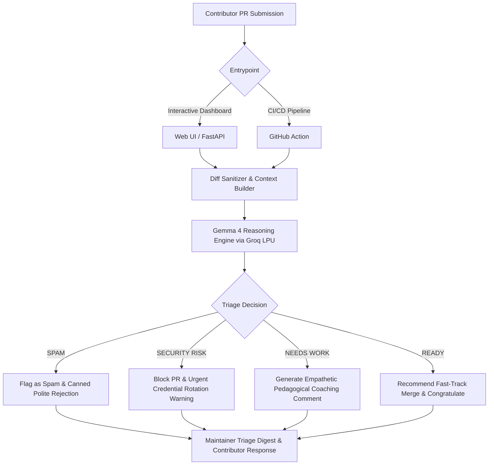

<div align="center">

# 🛡️ HacktoShield (Bermuda PR Shielder)
### The AI Sentinel & Contributor Mentor for Open-Source Repositories

[](https://hacktoberfest.com/)
[](https://ai.google.dev/gemma)
[-f55036?style=for-the-badge)](https://groq.com/)
[](https://fastapi.tiangolo.com/)
[](LICENSE)

<br/>

**Built in 4 hours for the MLH Hacktoberfest Hackathon.**  
HacktoShield stops open-source maintainer burnout while coaching first-time contributors with kind, actionable feedback powered by **Google Gemma 4** on **Groq LPU**.

[Live Demo](#-quick-start) • [Architecture](#-architecture) • [GitHub Action](#-drop-in-github-action) • [Presets](#-built-in-demo-presets)

</div>

---

## ⚡ The Crisis: October Maintainer Burnout

Every October, thousands of new developers flock to open-source for Hacktoberfest. This unleashes two simultaneous pain points:

1. **For Maintainers:** Drowning in hundreds of trivial PRs (random whitespace edits in `README.md`, automated spam). Reviewing these takes dozens of hours, leading to burnout.
2. **For Genuine Beginners:** When first-time contributors make an honest mistake (like a missing null check or forgotten unit test), overworked maintainers often leave blunt, discouraging comments like *"Rejected. Read guidelines."* Contributors feel intimidated and leave open source forever.

---

## 💡 The Solution: HacktoShield

**HacktoShield** serves as an intelligent filter and warm mentor between contributors and maintainers:

- **🚨 Spam & Trivial PR Bouncer:** Automatically detects low-effort edits submitted solely for swag/badges and flags them for quick closing.
- **🌱 Empathetic Contributor Mentor:** Rather than scolding beginners, Gemma 4 writes warm, pedagogical comments explaining *why* a bug exists and hints on how to resolve it.
- **🔥 Security & Leak Sentinel:** Instantly catches accidentally committed secrets (`GROQ_API_KEY`, `.env`, private tokens) before they cause a disaster.
- **👨‍💻 Maintainer 5-Second Digest:** Delivers a concise change summary, risk level, and suggested GitHub labels (`hacktoberfest-accepted`, `needs-work`, `security`).

---

## 🏛️ System Architecture



---

## 🚀 Quick Start (Run Locally in 60 Seconds)

### 1. Clone & Install
```bash
git clone https://github.com/AnshulKumar79/Bermuda_PR_Shielder.git
cd Bermuda_PR_Shielder
pip install -r backend/requirements.txt
```

### 2. Configure Environment (Optional)
Create `.env` (or run without key to use the built-in intelligent fallback mode):
```env
GROQ_API_KEY=gsk_your_groq_api_key_here
GEMMA_MODEL=gemma2-9b-it
PORT=8000
```

### 3. Launch Dashboard
```bash
python -m uvicorn backend.main:app --port 8000
```
Open **`http://localhost:8000`** in your browser!

---

## 🎮 Built-in Demo Presets (1-Click Judge Walkthrough)

To experience HacktoShield instantly without typing custom diffs, the dashboard includes 3 pre-loaded real-world scenarios:

1. **🚨 Spam README Edit:** Trivial whitespace edit in markdown to grab swag credit $\to$ Gemma marks `SPAM (95%)` and politely points to `good first issue` tags.
2. **🌱 First-Timer Edge Case:** Well-intentioned token refresh PR missing an expired null check $\to$ Gemma marks `NEEDS_IMPROVEMENT` and guides the beginner through the fix.
3. **🔥 Leaked API Key:** Contributor commits a production API key into `config/settings.py` $\to$ Gemma flags `CRITICAL_SECURITY_ALERT` with urgent remediation steps.

---

## 🤖 Drop-in GitHub Action

Add `.github/workflows/pr_shielder.yml` to any GitHub repository to enable automated triage on every Pull Request:

```yaml
name: "HacktoShield PR Sentinel"
on:
  pull_request:
    types: [opened, synchronize]

jobs:
  triage:
    runs-on: ubuntu-latest
    steps:
      - uses: actions/checkout@v4
      - uses: actions/setup-python@v5
        with: { python-version: "3.11" }
      - run: pip install -r backend/requirements.txt
      - name: Run Sentinel
        env:
          GROQ_API_KEY: ${{ secrets.GROQ_API_KEY }}
          GITHUB_TOKEN: ${{ secrets.GITHUB_TOKEN }}
        run: python -m automation.action_runner
```

---

## 👥 The Team & Hacktoberfest Spirit

Built with ❤️ for the global open-source community during MLH Hacktoberfest.

- **Open Source:** Licensed under [MIT](LICENSE).
- **Contributing:** Check out our [CONTRIBUTING.md](CONTRIBUTING.md) to get involved!